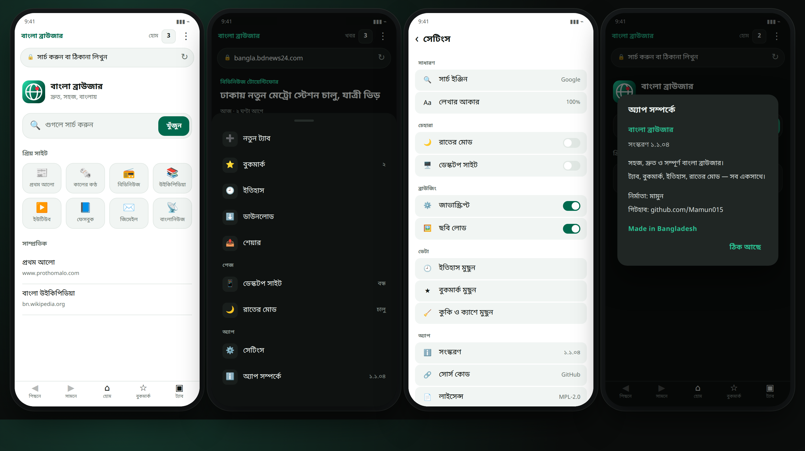

# বাংলা ব্রাউজার ১.১.০১

ছোট, দ্রুত ও সম্পূর্ণ বাংলা অ্যান্ড্রয়েড ব্রাউজার। এই রিলিজে আগের বাগগুলো ঠিক করা হয়েছে আর চেহারা আরও পরিষ্কার করা হয়েছে।

## ঠিক করা হয়েছে

- **মেনুর সব অপশন কাজ করে** — আগে মেনু বন্ধ হওয়ার সময় ক্লিকের কাজটা হারিয়ে যাচ্ছিল। এখন সেটিংস, বুকমার্ক, ইতিহাস, ডাউনলোড, শেয়ার, অ্যাপ সম্পর্কে — সব খোলে।
- **সেটিংস ও অ্যাপ সম্পর্কে** খুলছিল না, ঠিক হয়েছে।
- ছবি বা বিজ্ঞাপন লোড না হলে আর ভুল করে "পেজ লোড হয়নি" স্ক্রিন আসে না। এখন শুধু মূল পেজ ব্যর্থ হলে দেখায়।
- মেনু স্ক্রিনের বাইরে যেত, এখন উচ্চতা সীমিত আর ভেতরে স্ক্রল হয়।
- ট্যাব দরকার হলে লোড হয়, তাই অ্যাপ দ্রুত খোলে ও কম র‍্যাম নেয়।
- হোমে গেলে ঠিকানা বার ও পেজের নাম পরিষ্কার হয়।
- রাতের মোডে হোম পেজও অন্ধকার দেখায়।
- সেটিংসের সারিগুলো এখন গোলাকার, চাপলে টাচ ফিডব্যাক দেখা যায়।

## নতুন

- **অ্যাপ সম্পর্কে পেজ** — নির্মাতার তথ্য, গিটহাব লিংক আর **Made in Bangladesh**।
- **নতুন লঞ্চার আইকন** — বড় গ্লোব, উজ্জ্বল সবুজ-টিল গ্রেডিয়েন্ট, লাল ডট।
- **নতুন মেনু আইকন** — প্রতিটি আইকন গোলাকার হালকা বাক্সে, আগের চেয়ে বড় ও পরিষ্কার।
- হোম পেজেও আসল অ্যাপ আইকন।

## ইনস্টল

1. নিচের `BanglaBrowser-1.1.01.apk` ডাউনলোড করো।
2. ফোনের Downloads ফোল্ডারে ফাইলটিতে ট্যাপ করো।
3. Android অচেনা সোর্সের অনুমতি চাইলে Allow দাও, তারপর Install।

পুরোনো ভার্সন মুছতে হবে না। নতুন APK পুরোনোটার উপর বসবে, বুকমার্ক ও ইতিহাস থাকবে।

- **সংস্করণ:** 1.1.01 (versionCode 4)
- **সাইজ:** 105 KB
- **Android:** 5.0 (API 21) বা তার পরের
- **SHA-256:** `2e95d38c9efe705baf93e3dc5ec2c84c674dd108dc3256f009e989139181a761`

---

Version 1.1.01 fixes the menu actions that did nothing (Settings and About now open), adds a maker + "Made in Bangladesh" About page, a bigger colorful launcher icon, cleaner menu icons, lazy tab loading, a height capped menu sheet, and error pages only for failed main pages. Install over 1.1; bookmarks and history are kept.
